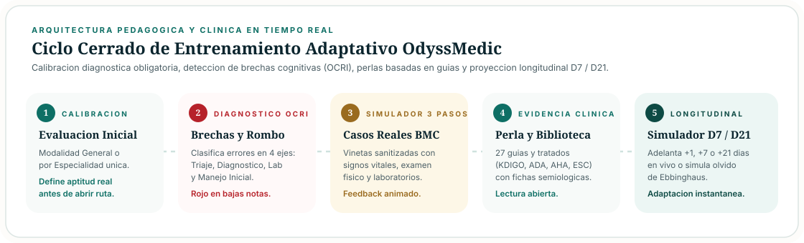
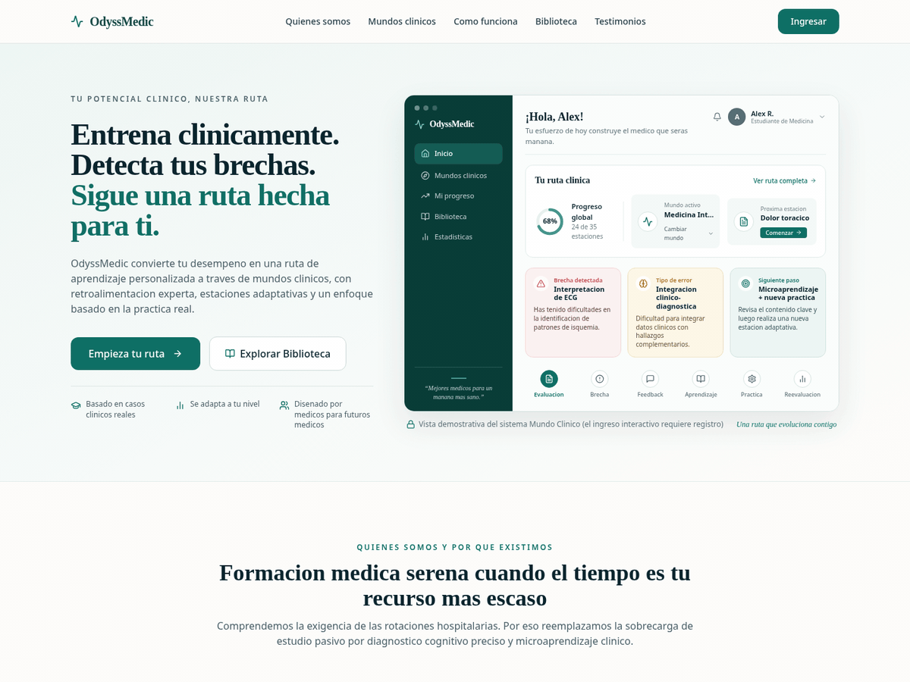
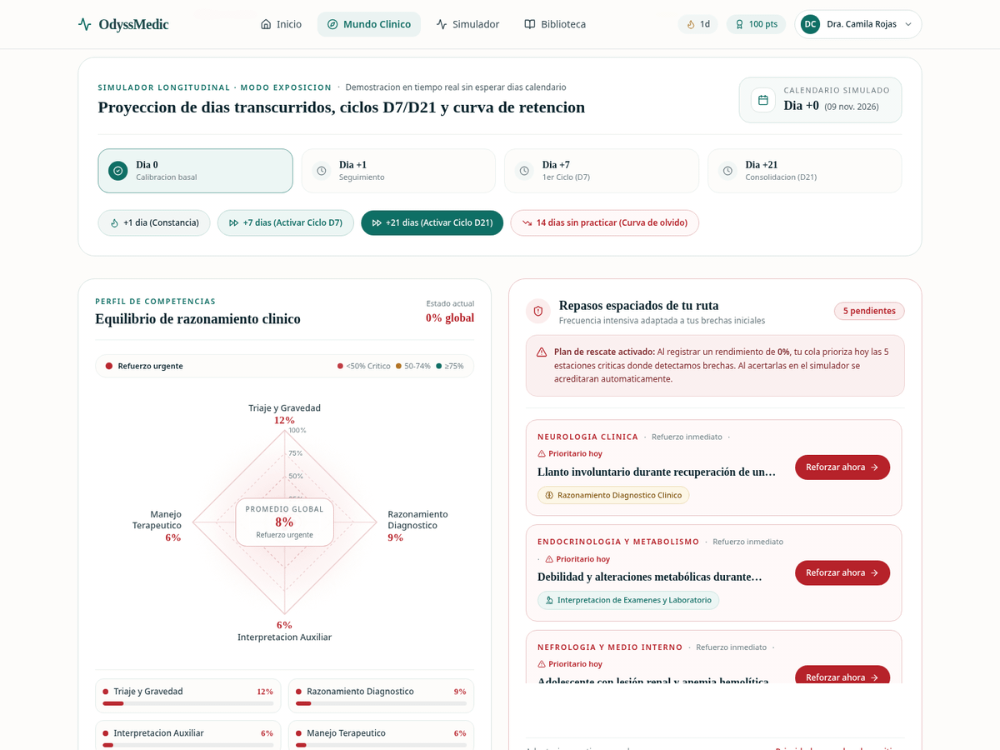
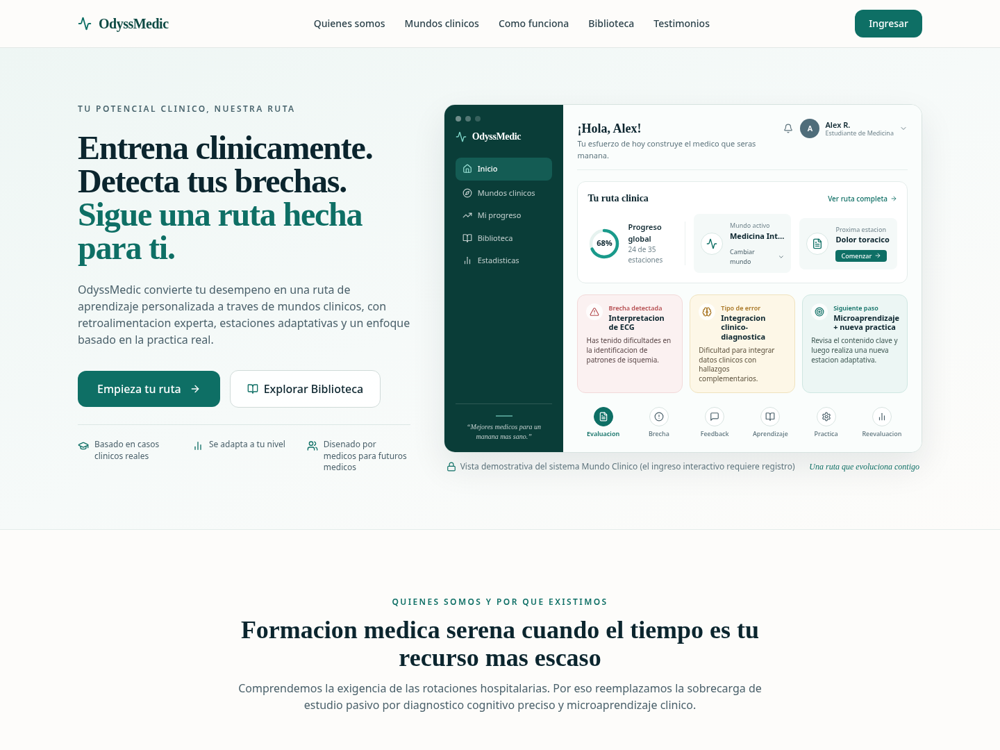
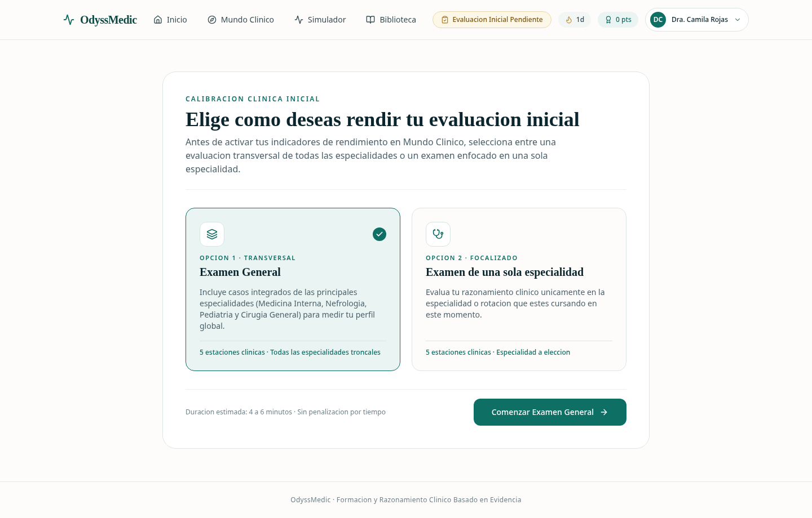
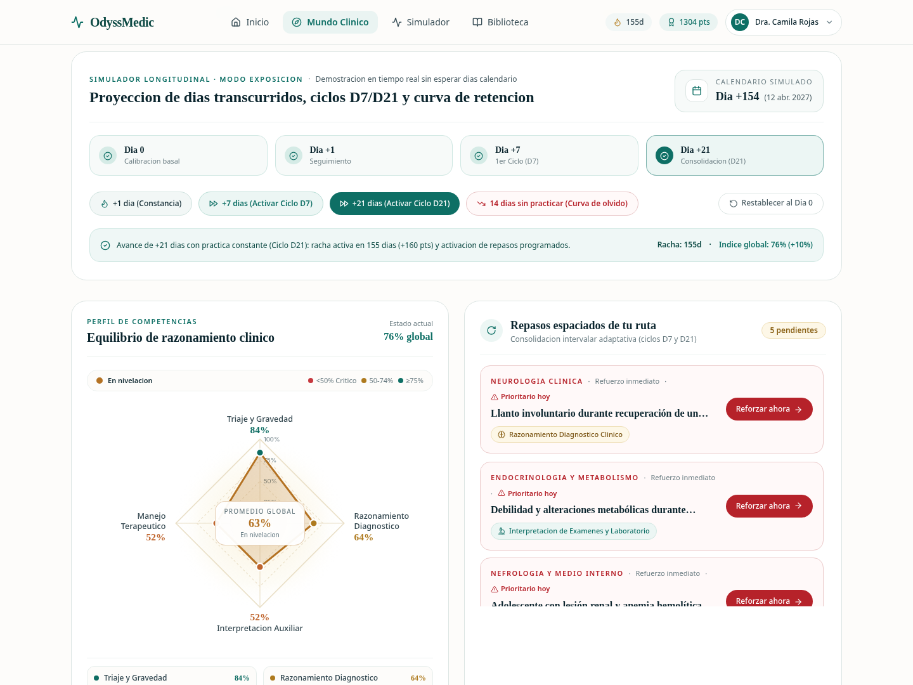
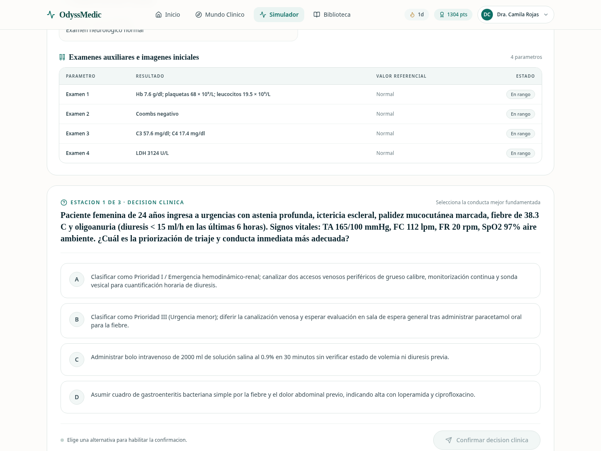
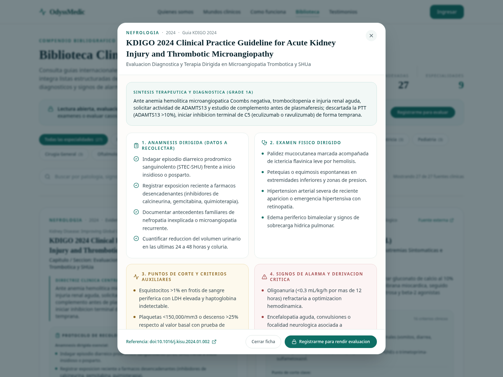

# OdyssMedic - Plataforma de Entrenamiento Clinico Adaptativo

Iniciativa desarrollada para el curso de **Proyectos de Ingenieria 2** (Universidad Peruana Cayetano Heredia - UPCH) y vinculada a la **BioIncubadora Cayetano 2026**.

**Autores:** Dario Huerta Cruz & Elvis Deiwis Pilco Cruz  
**Evaluador:** Mag. Noe Bazan



---

## 1. Demostracion Animada del Prototipo Full-Stack

OdyssMedic es una plataforma web interactiva (React 18 + TypeScript + FastAPI + SQLAlchemy) disenada para internos y estudiantes de medicina que se preparan para examenes clinicos de alto impacto (**ENAM, EsSalud y Residentado Medico**).

En lugar de evaluar respuestas estaticas de forma aislada, OdyssMedic calibra el punto de partida real del estudiante, diagnostica sus **brechas cognitivas (Taxonomia OCRI)** sobre casos clinicos reales arbitrados (*Journal of Medical Case Reports* - BMC), entrega **perlas clinicas respaldadas por 27 guias internacionales** y adapta en tiempo real su ruta de **repeticion espaciada (Ciclos D7 y D21)**.



---

## 2. Simulador de Dias Transcurridos (Modo Exposicion en Una Sola Sesion)

Dado que los intervalos reales de consolidacion de memoria clinica ocurren a lo largo de dias y semanas (**Dia +1**, **Ciclo D7** y **Ciclo D21**), el prototipo incorpora en el panel principal un **Simulador Longitudinal de Paso del Tiempo** conectado directamente al motor de persistencia del backend (`POST /api/v1/leveling/simulate-days`).

Esto permite demostrar en vivo durante una sola exposicion, sin esperar dias calendario:

1. **`+1 dia (Constancia)`**: incrementa la racha activa, acredita experiencia clinica y consolida gradualmente la retencion.
2. **`+7 dias (Activar Ciclo D7)`**: adelanta el reloj clinico una semana, habilitando como prioritarias las estaciones programadas en el primer intervalo de repaso espaciado.
3. **`+21 dias (Activar Ciclo D21)`**: activa la segunda ola de consolidacion a largo plazo y promueve estaciones previamente superadas en D7 para verificar retencion duradera.
4. **`14 dias sin practicar (Curva del Olvido de Ebbinghaus)`**: simula dos semanas de inactividad clinica, reiniciando la racha a `0 dias`, aplicando decaimiento de retencion y haciendo que el **Rombo de Equilibrio de Razonamiento Clinico vire progresivamente hacia ambar y rojo carmesi** junto con alertas urgentes de rescate.
5. **`Restablecer al Dia 0`**: devuelve el calendario simulado y los indicadores al estado basal posterior al examen diagnostico para repetir cualquier escenario frente al jurado.





---

## 3. Galeria Visual de Modulos Implementados (Frontend + Backend)

| Portada Editorial Clasica y Vista Previa Protegida | Modalidades de Evaluacion Diagnostica Inicial |
| :---: | :---: |
|  |  |
| **Estetica medica clasica (`Playfair Display` + `Inter`)**: explica visualmente la falta de tiempo del interno y muestra el sistema sin permitir interaccion clinica sin registro previo. | **Doble modalidad de calibracion**: el estudiante registrado elige entre **Examen General** (todas las especialidades) o **Examen de una sola especialidad**. |

| Ruta con Nota Baja (Rombo en Rojo + Plan de Rescate) | Evolucion Longitudinal con Simulador de Dias |
| :---: | :---: |
|  |  |
| **Calibracion honesta**: ante bajas calificaciones iniciales, el rombo se tine de rojo carmesi con halos de alerta y la cola activa refuerzos inmediatos reales. | **Proyeccion temporal D7 / D21**: avance en vivo del calendario simulado, racha consecutiva, puntos y evolucion geometrica del rombo de competencias. |

| Simulador Clinico en 3 Estaciones + Perla Clinica | Biblioteca Clinica Abierta y Recoleccion de Datos |
| :---: | :---: |
|  |  |
| **Retroalimentacion animada de acierto y fallo**: vinetas reales BMC sanitizadas con modal de debriefing, brecha detectada y referencia cientifica directa. | **27 fuentes en 9 especialidades**: fichas estructuradas de anamnesis, examen fisico, puntos de corte y signos de alarma (lectura abierta, examen protegido). |

---

## 4. Como Funciona el Motor Clinico Adaptativo

1. **Registro Progresivo y Calibracion Obligatoria**:
   - Al crear una cuenta (datos personales en el paso 1 y perfil academico/preferencias en el paso 2 sin saturar la pantalla), los indicadores de rendimiento permanecen bloqueados hasta completar el examen diagnostico inicial.
2. **Taxonomia de 4 Brechas Cognitivas (Modelo OCRI)**:
   - `GAP_TRIAGE_SEVERITY`: omision de signos de alarma, inestabilidad hemodinamica o priorizacion inicial.
   - `GAP_DIAGNOSTIC_REASONING`: error al integrar sintomas, signos semiologicos y factores de riesgo en un diagnostico diferencial preciso.
   - `GAP_LAB_INTERPRETATION`: lectura inadecuada de gases arteriales, electrolitos, frotis periferico, serologias o imagenes.
   - `GAP_INITIAL_MANAGEMENT`: eleccion incorrecta de terapia de primera linea, secuencia farmacologica insegura o retraso en medidas criticas.
3. **Actualizacion Dinamica de Maestria (EMA) y Cola Espaciada**:
   - Cada estacion resuelta en el simulador (`POST /api/v1/evaluation/submit-mcq`) actualiza la maestria por especialidad mediante Media Movil Exponencial ($\alpha = 0.25$), recalcula los 4 ejes del rombo cognitivo y agenda o acredita automaticamente tareas en `SpacedRepetitionTask`.

---

## 5. Carpeta de Referencias del Proyecto (`referencias/`)

Todas las referencias clinicas, bibliograficas, pedagogicas, normativas y tecnicas empleadas en el proyecto estan documentadas y estructuradas en la carpeta [**`referencias/`**](./referencias/README.md) (**50 fuentes verificables**):

- [**`referencias/01_casos_clinicos_indexados.md`**](./referencias/01_casos_clinicos_indexados.md): Los **7 reportes de casos clinicos reales** de *Journal of Medical Case Reports* (Springer Nature / BioMed Central) con enlaces DOI oficiales (`10.1186/s13256-...`).
- [**`referencias/02_guias_y_tratados_clinicos.md`**](./referencias/02_guias_y_tratados_clinicos.md): Las **27 guias de practica clinica internacionales y tratados medicos** (KDIGO, ADA, AHA/ASA, ESC, Surviving Sepsis, EULAR, ACOG, FIGO, AAP, TG18, WSES, ATLS, Harrison, Brenner, Nelson, Kanski) en 9 especialidades.
- [**`referencias/03_fundamentos_pedagogicos_y_cognitivos.md`**](./referencias/03_fundamentos_pedagogicos_y_cognitivos.md): Literatura sobre curva del olvido (Ebbinghaus), practica distribuida (Cepeda et al.), educacion espaciada en medicina (Kerfoot et al.), sesgos diagnosticos (Croskerry), Piramide de Miller y marcos ENAM / CONAREME.
- [**`referencias/04_arquitectura_y_diseno_editorial.md`**](./referencias/04_arquitectura_y_diseno_editorial.md): Especificaciones tecnicas de FastAPI, SQLAlchemy 2.0, Pydantic v2, React 18, TypeScript, Vite 6, Tailwind CSS y accesibilidad WCAG 2.1.
- [**`referencias/catalogo_completo_referencias.json`**](./referencias/catalogo_completo_referencias.json) y [**`referencias/referencias_odyssmedic.bib`**](./referencias/referencias_odyssmedic.bib): Exportaciones legibles por maquina y formato BibTeX para LaTeX / Zotero / Mendeley.

---

## 6. Estructura Completa del Repositorio

```text
OdysMedic/
├── README.md                                  # Documentacion general, animaciones y arquitectura Full-Stack
├── docs/
│   └── assets/                                # Diagramas SVG animados, GIFs en vivo y capturas de modulos
├── referencias/                               # Compendio maestro de las 50 referencias del proyecto
│   ├── README.md                              # Indice bibliografico general
│   ├── 01_casos_clinicos_indexados.md         # 7 casos reales BMC / Springer Nature con DOI
│   ├── 02_guias_y_tratados_clinicos.md        # 27 guias internacionales y tratados en 9 especialidades
│   ├── 03_fundamentos_pedagogicos_y_cognitivos.md # Ciencia cognitiva, repeticion espaciada y ENAM
│   ├── 04_arquitectura_y_diseno_editorial.md  # Stack de ingenieria de software y estandares UX
│   ├── catalogo_completo_referencias.json     # Catalogo estructurado en JSON
│   └── referencias_odyssmedic.bib             # Bibliografia en formato BibTeX
├── frontend/                                  # Aplicacion Web Interactiva (React 18 + TypeScript + Vite 6)
│   ├── README.md                              # Documentacion detallada de componentes y diseno editorial
│   ├── package.json                           # Dependencias y scripts de compilacion
│   ├── tailwind.config.js                     # Tokens clasicos y animaciones clinicas
│   └── src/
│       ├── pages/                             # Landing, DiagnosticExam, Dashboard, Simulator, Library
│       ├── components/                        # AuthModal, TimePassageSimulator, CompetencyRadar, PearlModal
│       ├── context/                           # Gestion reactiva de sesion JWT (AuthContext)
│       ├── hooks/                             # Interpolacion animada (useAnimatedNumber)
│       ├── services/                          # Cliente REST tipado hacia /api/v1
│       └── types/                             # Contratos TypeScript sincronizados con el backend
└── backend/                                   # API REST y Motor Adaptativo (FastAPI + SQLAlchemy 2.0)
    ├── README.md                              # Especificacion tecnica de endpoints y motor OCRI
    ├── requirements.txt                       # Dependencias de Python y testing
    ├── data/
    │   ├── clinical_cases.json                # 7 casos clinicos reales sanitizables
    │   └── medical_references.json            # 27 guias y listas de recoleccion semiologica
    ├── app/
    │   ├── main.py                            # Punto de entrada FastAPI, CORS y migracion idempotente
    │   ├── db/                                # Modelos ORM, sesion SQLite/PostgreSQL, seeder y banco diagnostico
    │   ├── models/                            # Esquemas Pydantic v2
    │   ├── engine/                            # Evaluador retrospectivo, clasificador OCRI y perlas clinicas
    │   ├── services/                          # Logica de estudiante, simulador de dias, casos y referencias
    │   └── api/                               # Rutas REST (/auth, /cases, /evaluation, /leveling, /references)
    └── tests/                                 # Suite automatizada con 82 pruebas de integracion y unidad
```

---

## 7. Guia Rapida de Instalacion y Ejecucion Full-Stack

### 7.1 Levantar el Backend (`http://localhost:8000`)

```bash
cd backend
python3 -m venv .venv
source .venv/bin/activate
pip install -r requirements.txt
PYTHONPATH=. uvicorn app.main:app --reload --host 0.0.0.0 --port 8000
```

- Documentacion interactiva OpenAPI (Swagger): `http://localhost:8000/docs`
- Ejecutar las **82 pruebas automatizadas**:
  ```bash
  cd backend && PYTHONPATH=. .venv/bin/pytest -v
  ```

### 7.2 Levantar el Frontend (`http://localhost:3000`)

En una segunda terminal:

```bash
cd frontend
npm install
npm run dev -- --host 0.0.0.0 --port 3000
```

- Aplicacion web en vivo: `http://localhost:3000`
- Compilacion de produccion y verificacion estricta de tipos:
  ```bash
  cd frontend && npm run build
  ```
